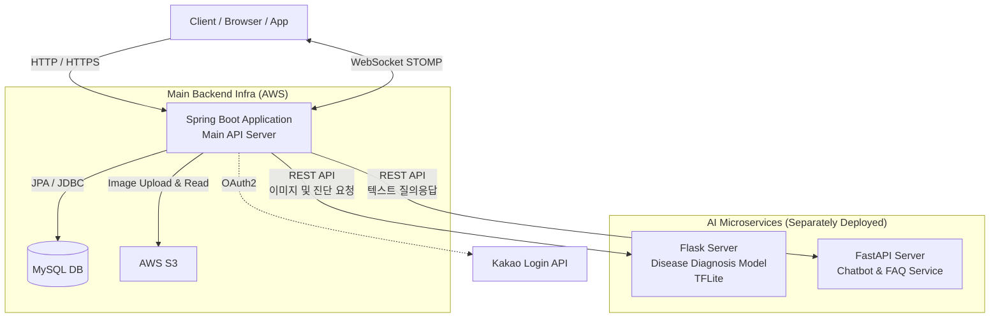

# SpaceFarm SERVER

도심농업 공간 중개 플랫폼 ‘SpaceFarm’의 백엔드 서버입니다.

Spacefarm은 홍익대학교와 마포구의 활기찬 분위기 속에서 잊혀진 버려진 공간과 유휴 공간을 새로운 가치로 재탄생시키는 도시 재생 프로젝트입니다. 저희는 높은 인구 밀도와 제한된 녹지 공간이라는 마포구의 지역적 특성에 주목했습니다. 특히 홍익대학교 근처의 자투리 공간, 옥상, 방치된 화단 등을 누구나 쉽게 텃밭으로 가꿀 수 있도록 연결하는 공간 공유 플랫폼을 제공합니다.

Spacefarm은 삭막한 도시 생활에 지친 현대인, 특히 바쁜 학업과 일상에 지친 홍익대학교 학생들과 지역 주민들에게 자연과 함께하는 건강한 휴식과 즐거움을 선사합니다. 단순히 텃밭을 분양하는 것을 넘어, 이웃과 함께 작물을 키우고 수확의 기쁨을 나누며 느슨하지만 따뜻한 지역 공동체를 형성하는 새로운 경험을 제공하는 것을 목표로 합니다.

## 📖 프로젝트 소개

**SpaceFarm**은 단순한 공간 중개를 넘어, **Vision AI 기반 진단**과 **챗봇과의 상호작용**, 그리고 사용자 간의 네트워킹을 결합한 서비스입니다.
핵심 비즈니스 로직을 처리하는 Spring Boot 메인 서버와 2개의 독립적인 AI 마이크로서비스(Flask, FastAPI)가 협력하여 작동합니다.

### 🔄 핵심 서비스 프로세스 (Core Flow)

1. **AI 병해 진단**: 사용자가 병든 작물(예: 배추 등)의 사진을 업로드하면, Spring 서버가 별도로 배포된 **Flask AI 서버**로 이미지를 전달하여 `TFLite` 모델 기반의 병해 진단 결과를 반환합니다.
2. **챗봇**: 작물 재배나 플랫폼 이용에 관한 질문을 입력하면, **FastAPI 챗봇 서버**로 프록시(Proxy)되어 FAQ 데이터 등을 바탕으로 맞춤형 답변을 제공합니다.
3. **공간 중개 및 커뮤니티**: 유저들은 자신의 농장(Farm)을 등록하고, 게시판(Post)과 리뷰(Review)를 통해 경험을 공유하며 코인/포인트를 활용한 모의 결제(Pay/Exchange) 시스템을 이용할 수 있습니다.
4. **실시간 네트워킹 (채팅)**: 관심 있는 농장주와 `WebSocket` 기반의 실시간 채팅방을 생성하여 1:1로 소통합니다.

## 🛠️ Tech Stack

| Category | Stack |
| --- | --- |
| **Language** | Java 17, Python 3.x |
| **Framework** | Spring Boot, Flask (병해 진단), FastAPI (챗봇) |
| **ORM / DB** | Spring Data JPA, MySQL |
| **Auth / Security** | Spring Security, JWT (Access/Refresh), OAuth2 (Kakao) |
| **Infra / Storage** | AWS S3 (이미지 저장) |
| **AI / ML** | TensorFlow Lite (`cabbage_disease_model.tflite`) |
| **Etc** | Lombok, WebSocket (STOMP), OpenAPI |

## ✨ Key Features

### 1. 분산형 AI 서비스 아키텍처

* **병해 진단 AI (Flask)**: 경량화된 `TensorFlow Lite` 모델을 Flask로 서빙하여, 빠르고 정확한 작물(배추 등) 질병 이미지를 판별.
* **챗봇 AI (FastAPI)**: `faq_data.csv` 및 자체 검색 로직을 활용한 대화형 챗봇 서버 별도 구축. Spring Boot 서버를 통해 원활하게 통신.

### 2. 농장 관리 및 재화(Coin/Pay) 시스템

* **Farm 시스템**: 농장 생성, 상세 조회 및 이미지 S3 연동 관리.
* **결제(Pay) 및 교환**: 코인 충전, 결제 이력 관리 및 재화 부족 예외 처리를 포함한 안전한 트랜잭션 관리.

### 3. 실시간 소통 (WebSocket Chat)

* **STOMP 기반 채팅**: 웹소켓을 활용해 채팅방 입장 및 퇴장, 메시지의 실시간 양방향 통신 지원.

### 4. 확장형 커뮤니티 시스템

* **게시판 & 리뷰**: 사용자 간 게시글, 리뷰 작성 기능 및 계층형 댓글 지원.
* **인터랙션**: 좋아요, 북마크 기능을 통한 콘텐츠 스크랩 및 랭킹화 기반 마련.

## 🔍 상세 기능 명세

### 🧩 인증 및 유저 관리 (Auth & Profile)

* **카카오 소셜 로그인** → OAuth2 인증을 거쳐 내부 규격에 맞는 JWT 발급.
* **토큰 인증/재발급** → JWT Access/Refresh 토큰 생성 및 만료 시 안전한 재발급 처리.
* **마이페이지 & 프로필** → 유저 정보 수정, 참여 중인 농장 이력 및 온보딩(Onboarding) 정보 관리.

### 🌱 농장(Farm) 및 커뮤니티

* **농장(Farm) CRUD** → 농장 생성, 리스트 상세 조회 및 검색 기능 제공.
* **커뮤니티 기능** → 커뮤니티 내 게시글 작성, 리뷰 남기기 및 댓글 등록.
* **인터랙션** → 좋아요 및 북마크 토글 기능으로 관심 게시글 스크랩 지원.

### 💰 결제 및 정산 (Pay)

* **포인트/코인 결제** → 농장 서비스 이용 및 가상 재화 교환을 위한 모의 결제 시스템 처리.

### 🔬 AI 병해 진단 & 챗봇 (AI Microservices)

* **진단 프록시** → 클라이언트에서 전달받은 농작물 이미지를 분리된 진단 AI(Flask) 서버로 전송하고 결과를 반환.
* **챗봇 프록시** → 클라이언트의 질문 텍스트를 챗봇 AI(FastAPI) 서버로 전달하여 맞춤형 응답을 수신 후 반환.

### 💬 실시간 채팅 (Chat)

* **채팅방 관리** → 1:1 채팅방 생성 및 특정 유저 초대.
* **실시간 메시징** → 웹소켓 연결 후 메시지 타입(입장, 퇴장, 대화 등)에 따른 실시간 브로드캐스팅.

## 🏛️ System Architecture

*Spring Boot 메인 서버가 클라이언트의 요청을 중앙에서 제어하며, 목적에 따라 분리 배포된 2개의 AI 서버(Flask, FastAPI)로 API 요청을 중계(Proxy)하는 마이크로서비스 구조입니다.*



## 📂 Project Structure

AI 모델 리포지토리(단일 레포 내 2개 서버)와 Spring Boot 메인 서버 리포지토리의 구조입니다.

### [1] Spring Boot (Main Server)

```bash
hongik_be
├── config          # Security, JWT, WebClient, S3, WebSocket 설정
├── controller      # API 엔드포인트 라우팅 (Auth, Farm, Chat, AI 등)
├── dto             # Request / Response 전송 객체
├── entity          # 데이터베이스 테이블 매핑 (User, Farm, Post 등)
├── exception       # 커스텀 비즈니스 예외 처리 로직
├── repository      # 데이터베이스 접근 계층
├── security        # 소셜 로그인 및 토큰 검증 로직
└── service         # 핵심 비즈니스 로직 및 외부 API 연동

```

### [2] AI Microservices (spacefarm-diagnose-ai)

```bash
spacefarm-diagnose-ai
├── / (Root - 병해 진단 Flask Server)
│   ├── flask_app.py                # 진단 API 라우터 및 로직
│   ├── cabbage_disease_model.tflite# 배추 병해 진단 추론 모델
│   ├── debug_model.py              # 모델 디버깅 모듈
│   └── Dockerfile                  # Flask 서버 배포용 도커파일
│
└── /main/src (Sub - 챗봇 FastAPI Server)
    ├── main.py                     # FastAPI 챗봇 엔드포인트
    ├── chatbot_model.py            # 대화 생성 및 검색 로직
    ├── faq_data.csv                # 챗봇 응답용 데이터베이스
    ├── fly.toml                    # Fly.io 배포 설정
    └── Dockerfile                  # FastAPI 서버 배포용 도커파일

```

## 🚀 Deployment

* **Main Backend (Spring Boot)**: Github 통합 관리 및 AWS (EC2/RDS/S3) 환경 배포.
* **Disease Diagnosis AI (Flask)**: TFLite 모델을 로드하여 이미지 추론에 최적화된 독립 서버로 배포 (Dockerfile 제공).
* **Chatbot AI (FastAPI)**: Fly.io (`fly.toml`) 등을 활용하여 빠르고 가벼운 챗봇 API 서버로 별도 배포.
